# dv1677-ht26-grupp5-frontend

## Gruppmedlemmar

| Namn                 | GitHub        |
| -------------------- | ------------- |
| Rebaz Mohammad Ahmad | rebahama      |
| Tuan Anh Pham        | tuananhpham95 |

## Om projektet
Detta projekt är utvecklat med React, en backend har driftsats och sänder ut olika API routes som konsumeras i detta projekt. Målet är att skapa en modern frontend webbapplikationen som presenterar olika routes ifrån backenden. Repo projektet skapades med Vite som startgrund.

## Kör lokalt

1. git clone <https://github.com/rebahama/dv1677-ht26-grupp5-frontend>
2. cd dv1677-ht26-grupp5-frontend
4. npm install
5. npm run dev

**Miljövariabler** :

| Variabel | Beskrivning |
|----------|-------------|
| VITE_API_URL | URL till backend-API:t |

## Installera dependencies 

1. npm install
Detta installerar följande:

* React
* React Router DOM
* Bootstrap
* React Bootstrap

## Bygga för produktion

Kör i root foldern "npm run build"

## Driftsatt

- Frontend: https://rebahama.github.io/dv1677-ht26-grupp5-frontend
- Backend:  https://dv1677-spock.nplab.bth.se

## Funktionalitet

#### Visa resurer:
Här displayas alla resurer ifrån broken, man måste vara inloggad för att kunna skapa en bokning på resursen som visas.

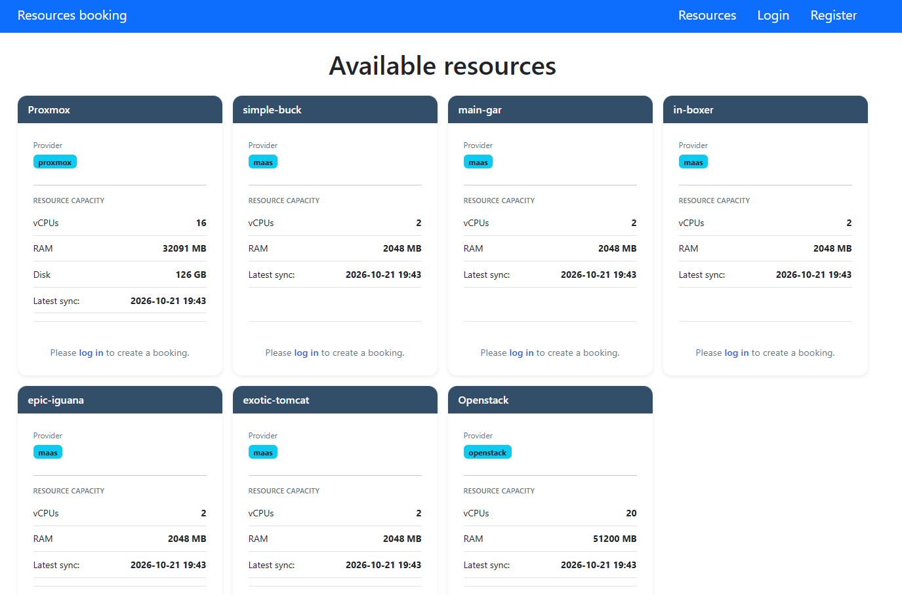

En detaljerad resurs:

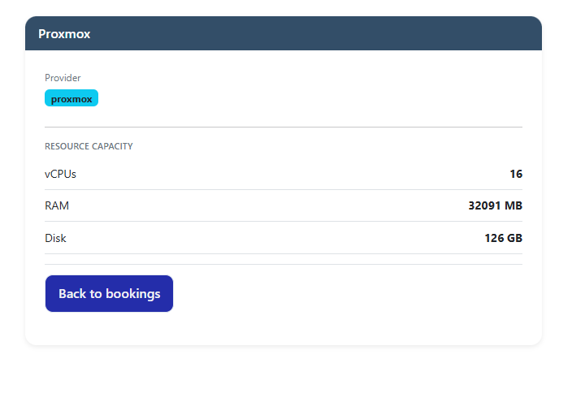

#### Inloggning och registera konto

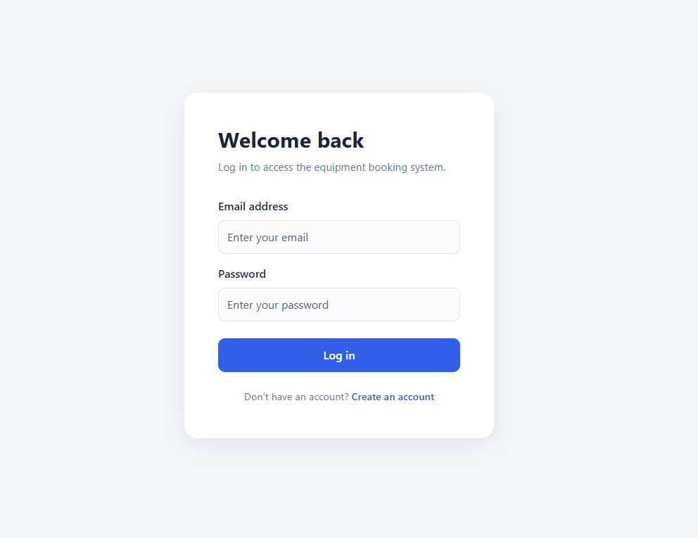

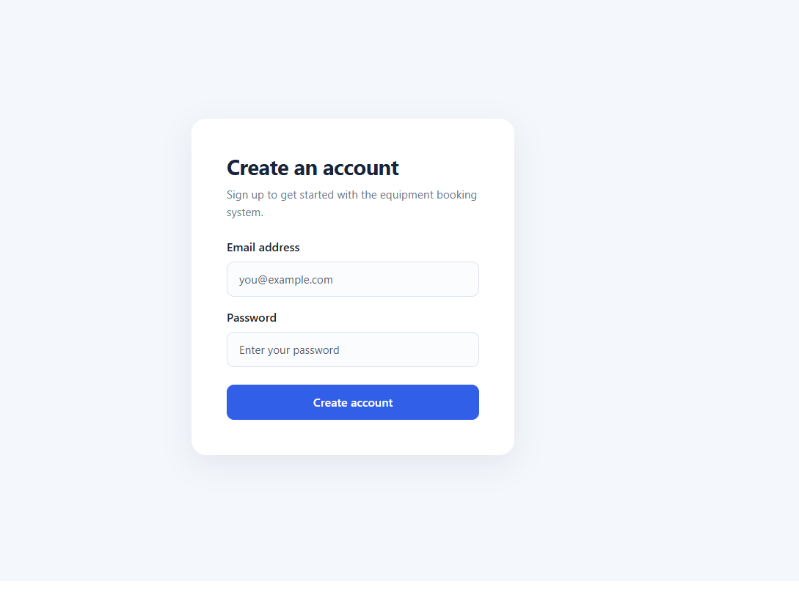

#### Boka resurs

När användare är inloggad kan man skapa bokningar:

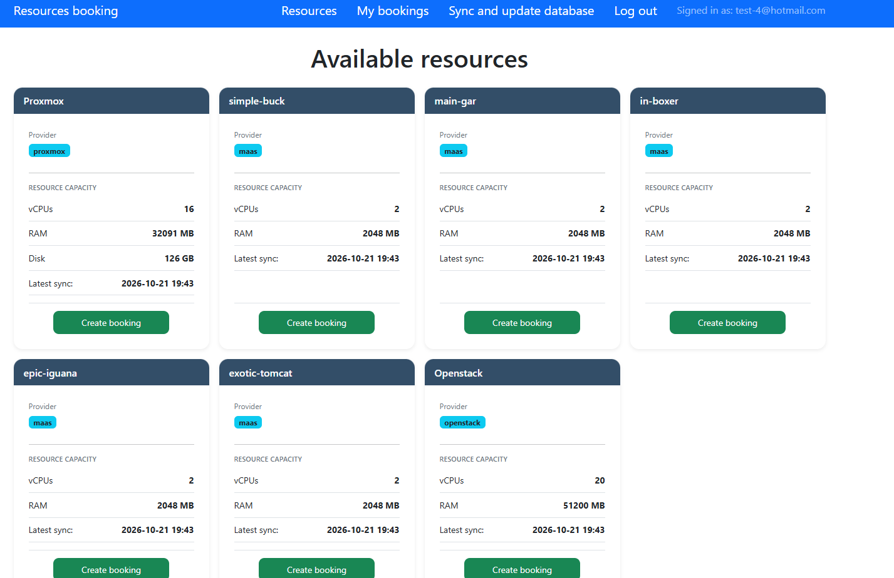

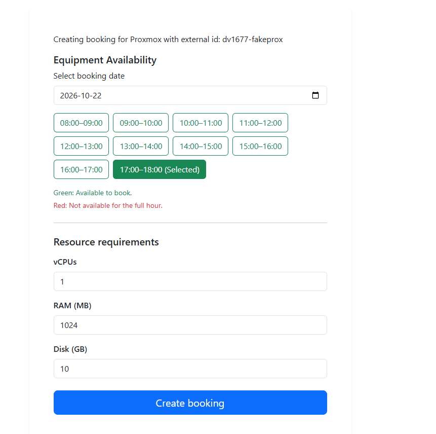

Den detaljerade bokningen:

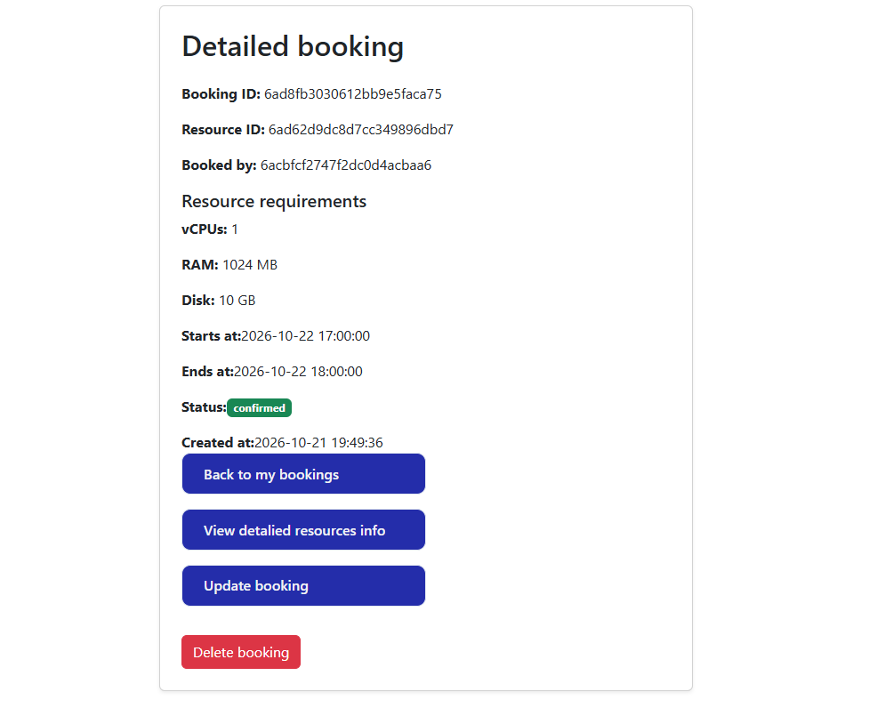

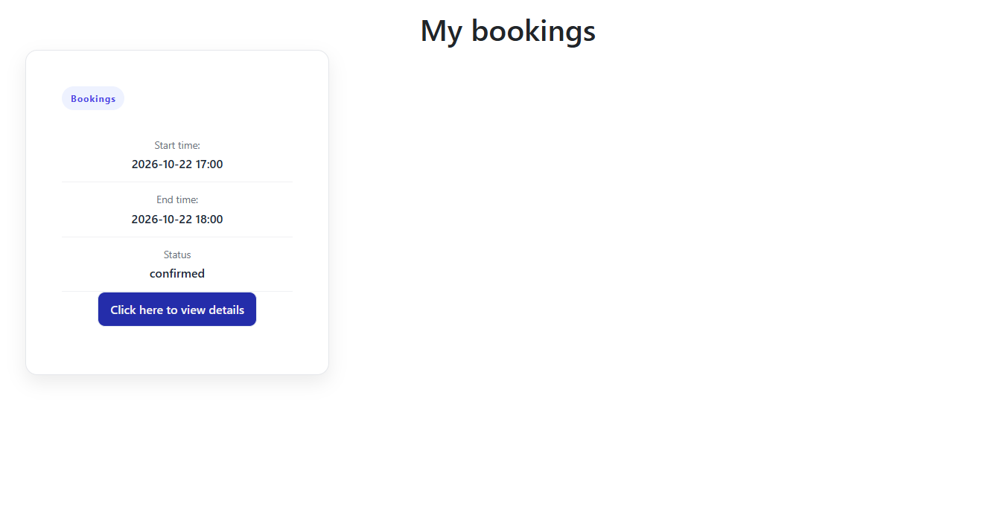

Om man försöker boka samma resurs med samma tid som den första resursen som bokades syns följande time slot som är rött eftersom det redan finns en bokning den dagen och tiden.

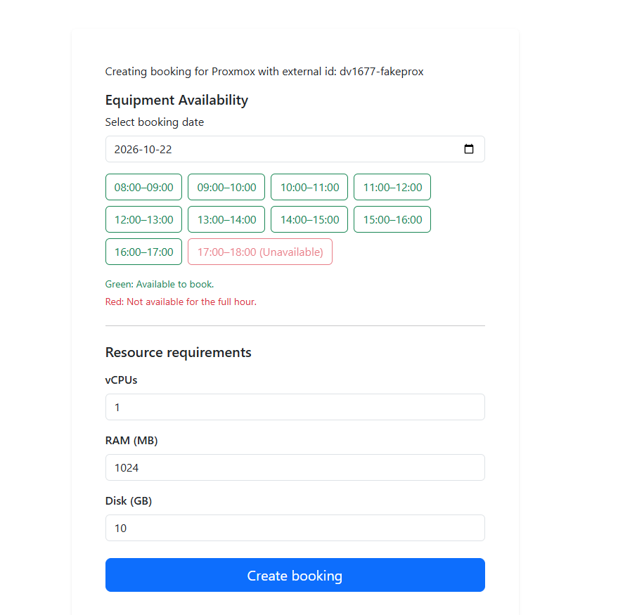

Om man försöker boka en tid som är tidigare än dagens datum och tid.

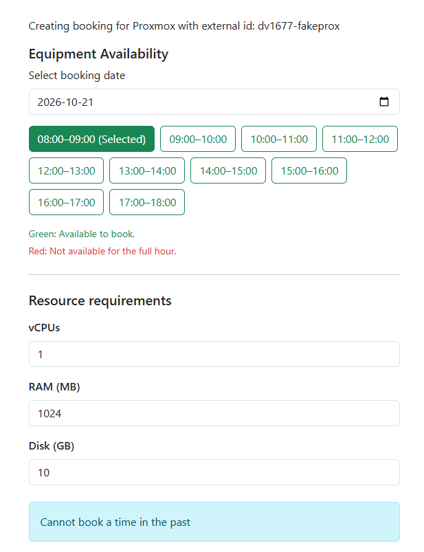

Om kapaciteten överskrider det som broker har att erbjuda:

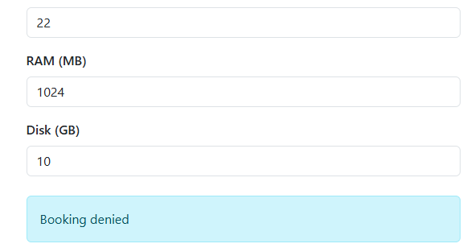

#### Synkronisera brooker data till lokala backend databas

Avnändare kan synkronisera data ifrån broker till den lokala databasen, detta updaterar den befintliga databasen och lägger in den nya datan ifrån broker till databasen. När synken har lyckats så uppdateras även fieldsen som finns på resurser till att visa tid och datum när den senaste synken ägde rum.

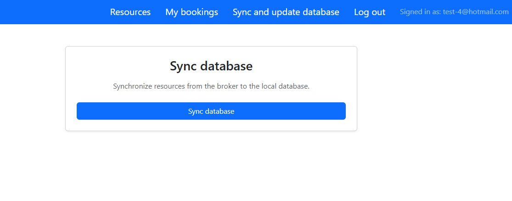

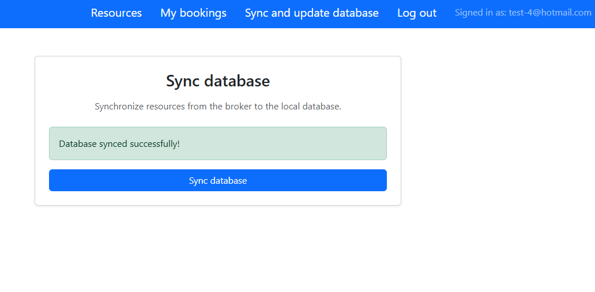

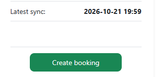

#### No permission

Om användare föröker besöka skyddade routes syns följande:

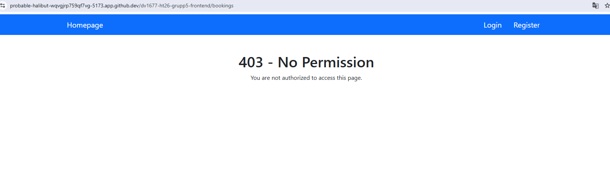

## Tillvägagångssätt

Dokumentera löpande vad ni gjort och hur ni löst problem.

- Vecka 3: React installerades och konfiguerades med hjälp av Vite, även React Bootstrap lades till för styling. React router dom lades till för att kunna navigera runt webbapplikationen. En display API sida React component skapades för att förberedas när API ifrån backend projektet konsumeras på frontenden.

- Vecka 4: När API var driftsatt ifrån backenden kunde arbete påbörjas att konsumera APIn här i frontenden, en display api sida skapades och där API ifrån frontenden displayas och visar innehåll. Sedan lades variabel: VITE_API_URL för backendens url in i Githup pages och en workflow skapades för main. Stötte på lite problem när jag skulle deploya sidan men visade sig att vara felstavningar och routes som var problemet här. Var tvungen att även pusha till main pga felstavning för att säkerhetställa driftsättningen gick korrekt till och displayade rätt utan att skapa en 404 error.

- Vecka 7:

    Påbörjades arbetet i frontend och att kunna skapa ett konto och logga in, ett context auth fil skapades så att man har tillgång till auth data och tokens på flera ställen i appen och som gör det lätt att importera och använda auth för att exempelvis veta vem som är inloggad och vems bookningar skall kunna synas samt sätta tokens.

    Ett my booking page skapades för att displaya användarens bookningar, endast användaren som är inloggad har tillgång till sina bookningar, om någon annan försöker gissa id på bookningen så får man ett unauthorized fel meddelandet på backenden. Konto skapades på webbplatsen och bokningar skapades till 2 olika konton, båda konton visar sina egna relevanta bokningar i my booking sidan och man kan inte se varandras bokningar.

    Bookningarna displayas med hjälp av BookingCardProps filen som destructar fieldsen ifrån backenden och sedan importeras den till my bookings där den loopas genom och identiferas med ett id samt displyar relevanta fields.

- Vecka 8:

    När broker blev integrerad i backenden så kunde frontenden börja kommunicera med backenden som i sin tur kommunicerade med broker. Resrouces kan ifrån broker kan bokas med hjälp av webpage/CreateBooking.jsx filen. Här skickas relevanta fields till backenden som i sin tur skickar tillbaka ett svar. De flesta jsx filerna har skapats i props format, alltså en props fil har skapats som destructar relevanta fields och sedan skapas en till jsx fil som loopar över dessa props i .map funktionen och använder sig av key.id för att sedan displaya resultatet. Detta för att hålla koden organiserad och lättläst.

- Vecka 9:

    En synk sida har skapatas i SyncDatabase.jsx filen och där skickar den en anrop till backend som i sin tur skickar anrop till broker. Sedan skickas en uppdaterat databas lista som displays i resource sidan. En synk field lades till i resource databas för att visa för användaren när något synkades senast.En availability.jsx fil skapades för att anropa backenden där alla tillgänliga tider finns, om en variabel inte innehåller en viss tid så displays den tiden för användaren och om en variabel innehåller exemplevis en bokad tid så displays den tiden med att det inte går att boka just den tiden på en resurs.

## Tekniker
Projektet är byggd med:
* React: 19.2.8
* React Router Dom: 7.18.4
* Bootstrap: 5.3.8
* React Bootstrap: 2.10.10
* Vite: 8.3.0
* axios: 1.20.0